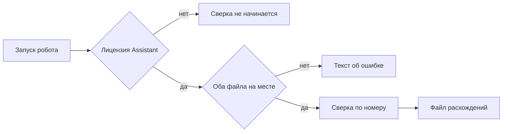

# Сверка двух таблиц

Робот называется **«Сверка двух таблиц»**. Пользователь кладёт в одну папку выгрузку и отчёт, запускает робота в Sherpa на своём компьютере и получает файл расхождений. Письма никуда не уходят. Чужие системы робот не открывает.

Сверка начинается только если включена лицензия Sherpa Assistant. Это проверка среды, а не настройка внутри робота. Без лицензии сверка не начинается: робот не читает выгрузку и отчёт как рабочий прогон и файл расхождений этим запуском не появляется. Это другой отказ, чем отсутствие файла: тогда робот уже запустился и пишет текст «Не найден файл для сверки».

Sherpa Designer ставится без лицензии. Чтобы прогнать робота, нужна лицензия Sherpa Assistant. На базовом курсе Sherpa её дают на месяц.

Сейчас при включённой лицензии робот проверяет, что в папке оба файла, читает колонки, останавливается при повторе номера, считает расхождения и пишет файл расхождений целиком новым файлом.

## Куда положить файлы

Рабочая папка задаётся переменной `Papka`. В неё положите два файла:

- `vigruzka.csv` — выгрузка
- `otchet.csv` — отчёт

Учебные копии этих файлов лежат в `samples/`.

## Что происходит при запуске

Если лицензии Assistant нет, сверка не начинается. Файл расхождений этим запуском не появляется. Текст «Не найден файл для сверки» тоже не пишется: робот до проверки папки не дошёл.

Если лицензия есть, а выгрузки нет, отчёта нет или нет обоих, в папке появляется текст `oshibka.txt` с одной строкой: «Не найден файл для сверки». Файл расхождений робот не создаёт. Если рядом уже лежал старый `rashozhdeniya.csv`, он остаётся как был.

Повторный запуск при отсутствии файла снова пишет тот же текст ошибки целиком, а не дописывает его вниз.

Если оба файла на месте, робот читает колонки `nomer`, `summa`, `status`. Номер и статус — текст без пробелов по краям, сумма — число. Ключ строки — `nomer`.

Если один и тот же номер встречается дважды в выгрузке или дважды в отчёте, в папке появляется `oshibka.txt` с одной строкой: «Повторяется номер в одном файле». Расхождения не собираются. Если рядом уже лежал старый `rashozhdeniya.csv`, он остаётся как был. Текст «Не найден файл для сверки» в этом случае не пишется.

Если повторов нет, робот вызывает `sverit(vigruzka, otchet)` и записывает `rashozhdeniya.csv` целиком новым файлом: не дописывает строки вниз при повторном запуске. Совпавшие номер, сумма и статус в файл не входят. Если у одного номера не сошлись и сумма, и статус, в файле одна строка с типом `summa`. Пустая группа — нормальный результат, не сбой: файл всё равно создаётся. Порядок групп: сначала разные сумма или статус, затем только в выгрузке, затем только в отчёте. Внутри группы строки идут по `nomer` как по тексту.

Первые две строки сводки: `nomerov` и `rashozhdeniy`. Дальше заголовок колонок и строки. Кодировка UTF-8, разделитель запятая. Сумма без лишних нулей после запятой.

Поля строки: `tip`, `nomer`, `summa_vigruzka`, `summa_otchet`, `status_vigruzka`, `status_otchet`. Где значения нет — пусто. Типы: `summa`, `status`, `net-v-otchete`, `net-v-vigruzke`. `nomerov` — число разных номеров во множестве ключей. `rashozhdeniy` — длина списка.

Для учебных файлов сводка: четыре номера, три расхождения. Строки: 102 тип `summa` (суммы 500 и 450), 103 тип `net-v-otchete`, 104 тип `net-v-vigruzke`. Номера 101 нет. Повторный запуск с теми же файлами даёт тот же файл, строки не задваиваются. Если после успешного прогона убрать отчёт и запустить снова, файл расхождений остаётся как был: робот не подменяет его пустым успехом и пишет, что файл для сверки не найден. Эталон успешного файла — `samples/expected-rashozhdeniya.csv`.

## Как запустить робота

1. Установите Sherpa Designer. Designer ставится без лицензии. Дистрибутив Windows: https://docs.sherparpa.ru/ssylki-na-distributivy/distributivy-sherpa-rpa-windows
2. Откройте проект робота в Designer.
3. Чтобы прогнать робота, нужна лицензия Sherpa Assistant. Её на месяц дают на базовом курсе: https://sherparpa.ru/besplatnyj-bazovyj-kurs/
4. Положите в одну папку выгрузку и отчёт. Рабочая папка задаётся переменной `Papka`.
5. Запустите робота «Сверка двух таблиц».

Документация Sherpa: https://docs.sherparpa.ru/sherpa-rpa

## Сценарий проверки

1. Положить учебную выгрузку и учебный отчёт. Запустить робота «Сверка двух таблиц». В файле расхождений сводка: четыре номера, три расхождения. Номер 102 с разными суммами. Номер 103 только в выгрузке. Номер 104 только в отчёте. Номера 101 в расхождениях нет.
2. Запустить робота ещё раз с теми же файлами. Строки не задвоились.
3. Убрать отчёт и запустить снова. Нового файла расхождений нет, в папке есть текст, что файл для сверки не найден. Уже лежавший успешный файл расхождений остаётся как был.

---

# Техническое приложение

## Файлы

| Путь | Зачем |
| --- | --- |
| `README.md` | Как получить лицензию, куда класть файлы и три проверки из задания |
| `robot/sverka.sherpa` | Проект Sherpa Designer 1.44 |
| `robot/sverka.process` | Живая диаграмма Designer (Start, проверка файлов, FileWrite, InvokeExpression) |
| `robot/_build-process.ps1` | Сборка `sverka.process` из блоков библиотеки Sherpa |
| `robot/progon-kontrakta.ps1` | Прогон контракта диаграммы, если Sherpa Assistant здесь нельзя запустить |
| `samples/vigruzka.csv` | Учебная выгрузка шага 1 |
| `samples/otchet.csv` | Учебный отчёт шага 1 |
| `samples/expected-rashozhdeniya.csv` | Эталон шага 1 построчно |
| `Papka/rashozhdeniya.csv` | Результат шагов 1–2; шаг 3 его не затирает |
| `Papka/oshibka.txt` | Результат шага 3 |

## Методы и параметры

Лицензия проверяется средой Sherpa Assistant до пользовательской диаграммы. В контракте робота нет параметра `licenziya=true`.

Без лицензии процесс сверки не стартует, `Papka/rashozhdeniya.csv` этим запуском не создаётся. Отсутствие файла — другой отказ: диаграмма уже работает и пишет `oshibka.txt`.

Рабочая папка — переменная `Papka`. Имена: `vigruzka.csv`, `otchet.csv`, результат `rashozhdeniya.csv`. Ошибка отсутствия файла: `oshibka.txt` с текстом `Не найден файл для сверки`. Повторный успешный прогон перезаписывает `rashozhdeniya.csv` целиком, не дописывает строки. При отсутствии отчёта успешный файл не трогать.

Эталон шага 1:

```csv
nomerov,4
rashozhdeniy,3
tip,nomer,summa_vigruzka,summa_otchet,status_vigruzka,status_otchet
summa,102,500,450,оплачен,оплачен
net-v-otchete,103,200,,новый,
net-v-vigruzke,104,,300,,оплачен
```

## Примеры

Кода проверки лицензии в диаграмме нет: среда не пускает прогон до блоков сверки. Designer ставится без лицензии; прогон требует Sherpa Assistant. Если Assistant недоступен, `robot/progon-kontrakta.ps1` повторяет шаги `robot/sverka.process` и пишет те же файлы в `Papka`.

## Блок-схема


