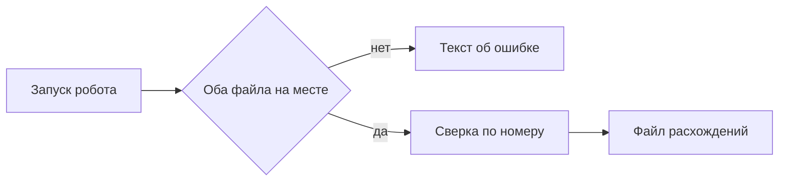

# Сверка двух таблиц

Робот на Sherpa RPA для одного прогона сверки. Пользователь кладёт в папку выгрузку и отчёт, запускает робота и получает файл расхождений. Письма никуда не уходят, чужие системы робот не открывает.

Оркестратор, очереди задач и распознавание документов задуманы, ещё нет.

## Что видит пользователь

Пользователь открывает Sherpa на своём компьютере и запускает робота «Сверка двух таблиц». Робот смотрит одну папку. В ней должны лежать два файла: выгрузка и отчёт. В обоих есть номер, сумма и статус.

Если оба файла на месте, робот пишет новый файл расхождений. Вверху короткая сводка: сколько разных номеров он увидел и сколько расхождений нашёл. Ниже три группы строк.

В первой группе номер есть в обоих файлах, но сумма или статус не совпали. В строке видны оба значения. Во второй группе номер есть только в выгрузке. В третьей группе номер есть только в отчёте. Совпавшие строки в файл расхождений не попадают. Пустой список в одной из групп — нормальный результат, не сбой.

Если выгрузки или отчёта нет, файл расхождений не создаётся. В папке появляется текст «Не найден файл для сверки». Уже лежавший рядом старый файл расхождений робот не подменяет новым пустым успехом.

Повторный запуск с теми же двумя файлами даёт тот же файл расхождений. Робот не дописывает вторую копию тех же строк вниз.

Если лицензия робота не включена, сверка не начинается и файл расхождений не появляется.

## Сценарий проверки

1. Положить учебную выгрузку и учебный отчёт. Запустить робота. В файле расхождений сводка: четыре номера, три расхождения. Номер 102 с разными суммами. Номер 103 только в выгрузке. Номер 104 только в отчёте. Номера 101 в расхождениях нет.
2. Запустить робота ещё раз с теми же файлами. Строки не задвоились.
3. Убрать отчёт и запустить снова. Нового файла расхождений нет, в папке есть текст, что файл для сверки не найден.

---

# Техническое приложение

Папка проекта: `sherpa-sverka`. Кода робота пока нет. Ниже контракт первой версии. Блоки Sherpa в документ не выдуманы: их выбирают в Sherpa Designer по этому контракту.

Sherpa Designer ставится без лицензии. Чтобы прогнать робота, нужна лицензия Sherpa Assistant. На базовом курсе Sherpa её дают на месяц: https://sherparpa.ru/besplatnyj-bazovyj-kurs/. Дистрибутив Windows: https://docs.sherparpa.ru/ssylki-na-distributivy/distributivy-sherpa-rpa-windows. Документация: https://docs.sherparpa.ru/sherpa-rpa.

## Файлы

| Путь | Зачем |
| --- | --- |
| `TZ.md` | Это задание |
| `robot/sverka.sherpa` | Проект Sherpa Designer |
| `robot/sverka.process` | Диаграмма робота |
| `samples/vigruzka.csv` | Учебная выгрузка |
| `samples/otchet.csv` | Учебный отчёт |
| `samples/expected-rashozhdeniya.csv` | Ожидаемый результат прогона |
| `README.md` | Куда положить файлы и как запустить робота |

Имена входных файлов в рабочей папке: `vigruzka.csv` и `otchet.csv`. Результат: `rashozhdeniya.csv`. Ошибка отсутствия файла: `oshibka.txt`.

## Методы и параметры

Колонки обоих входов: `nomer`, `summa`, `status`. Номер сравнивается как текст без пробелов по краям. Сумма сравнивается как число. Статус сравнивается как текст без пробелов по краям.

Ключ строки — `nomer`. Два одинаковых номера в одном файле — ошибка входных данных: робот пишет `oshibka.txt` и не собирает расхождения.

`sverit(vigruzka, otchet) -> rashozhdeniya`.

Строка результата:

| Поле | Смысл |
| --- | --- |
| `tip` | `summa`, `status`, `net-v-otchete`, `net-v-vigruzke` |
| `nomer` | номер строки |
| `summa_vigruzka` | сумма из выгрузки или пусто |
| `summa_otchet` | сумма из отчёта или пусто |
| `status_vigruzka` | статус из выгрузки или пусто |
| `status_otchet` | статус из отчёта или пусто |

Если у одного номера не сошлись и сумма, и статус, пишется одна строка с типом `summa`. Сводка в первых двух строках файла: `nomerov` и `rashozhdeniy`.

Учебные строки:

Выгрузка: 101 / 1000 / оплачен; 102 / 500 / оплачен; 103 / 200 / новый.

Отчёт: 101 / 1000 / оплачен; 102 / 450 / оплачен; 104 / 300 / оплачен.

Ожидание: три строки расхождений. 102, тип `summa`, суммы 500 и 450. 103, тип `net-v-otchete`. 104, тип `net-v-vigruzke`. Сводка: номеров 4, расхождений 3.

## Примеры

Кода робота в папке ещё нет, поэтому здесь нет фрагмента сценария Sherpa. Контракт прогона задают учебные строки выше. После сборки в Designer ожидаемый файл должен совпасть с ними построчно.

## Блок-схема

