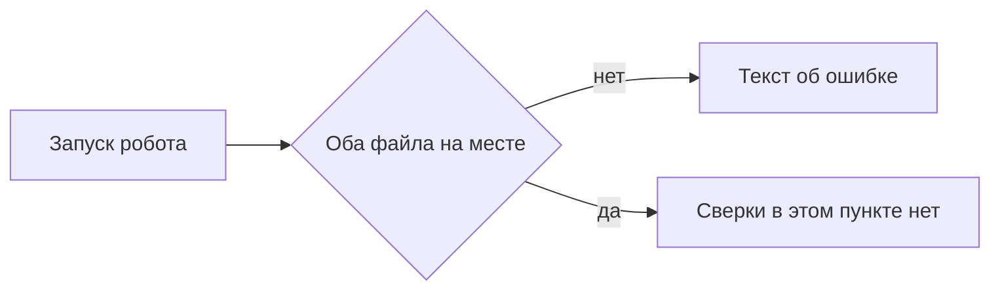

# Промт 02. Оба файла на месте

Ты добавляешь роботу первую проверку, которую пользователь замечает сразу. Робот смотрит одну папку. В ней должны лежать выгрузка и отчёт. Если оба на месте, сверка ещё не считается: этот пункт только про наличие файлов. Если какого-то файла нет, файл расхождений не появляется, а в папке лежит текст, что файл для сверки не найден. Уже лежавший рядом старый файл расхождений робот не подменяет новым пустым успехом.

Письма никуда не уходят. Чужие системы робот не открывает. Оркестратор, очереди и распознавание документов задуманы, ещё нет.

## Что уже есть

Пункт 01 сделан: каркас `robot/`, учебные CSV в `samples/`, `README.md`, переменная `Papka`. Сверки по номеру ещё нет.

## Что сделать в этом пункте

Робот «Сверка двух таблиц» читает одну папку `Papka`.

Ожидаемые имена: `vigruzka.csv` и `otchet.csv`.

Если оба файла есть — остановиться до сверки, файл расхождений не создавать, текст ошибки не писать.

Если нет выгрузки, нет отчёта или нет обоих:

- файл `rashozhdeniya.csv` не создавать
- уже лежащий `rashozhdeniya.csv` не затирать и не дополнять
- в папке появляется `oshibka.txt` с текстом `Не найден файл для сверки`

Повторный запуск при отсутствии файла снова пишет тот же текст ошибки, а не копирует его вниз бесконечно, если файл ошибки уже есть с тем же текстом.

## Чего не делать

Не разбирать колонки и не сравнивать суммы. Не выдумывать имена блоков Designer. Не слать письма. Не трогать чужие системы. Не считать сводку расхождений.

## Сценарий проверки

1. Положить в папку оба учебных файла. Запустить робота. Файла расхождений нет, текста ошибки нет, учебные файлы на месте.
2. Убрать отчёт и запустить снова. Нового файла расхождений нет. В папке есть текст «Не найден файл для сверки».
3. Положить рядом старый файл расхождений, снова убрать отчёт, запустить. Старый файл расхождений остался как был.

---

# Техническое приложение

## Файлы

| Путь | Зачем |
| --- | --- |
| `robot/sverka.process` | Проверка наличия двух файлов |
| `samples/vigruzka.csv` | Учебная выгрузка для проверки «оба на месте» |
| `samples/otchet.csv` | Учебный отчёт |
| `Papka/vigruzka.csv` | Имя входа в рабочей папке |
| `Papka/otchet.csv` | Имя входа в рабочей папке |
| `Papka/oshibka.txt` | Текст при отсутствии файла |
| `Papka/rashozhdeniya.csv` | Не создавать и не затирать в этом пункте |

## Методы и параметры

Проверка до любой сверки:

- есть `Papka/vigruzka.csv` и `Papka/otchet.csv` → продолжения сверки в этом пункте нет, ошибку не писать
- иначе записать `Papka/oshibka.txt` целиком текстом `Не найден файл для сверки` и выйти
- не создавать `Papka/rashozhdeniya.csv`
- если `rashozhdeniya.csv` уже есть, не удалять и не перезаписывать

Шаги в Designer описывай действиями: проверить файл, записать текст, выйти. Имена блоков не выдумывать.

## Примеры

Кода робота в репозитории может ещё не быть в читаемом виде. Контракт ошибки:

```txt
Не найден файл для сверки
```

## Блок-схема



## Критерий готовности

Нет выгрузки или отчёта → есть `oshibka.txt` с точным текстом, `rashozhdeniya.csv` не появляется и не затирается. Оба файла на месте → ошибки нет, расхождения ещё не считаются.
