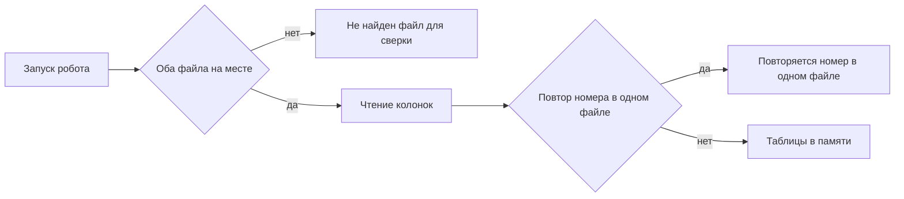

# Промт 03. Разбор колонок и повтор номера

Ты учишь робота читать два файла так, как их сравнивают люди: номер и статус без пробелов по краям, сумма как число. Если в одном файле один и тот же номер встречается дважды, это ошибка входных данных. Пользователь видит текст ошибки в папке. Файл расхождений в этом случае не собирается.

Письма никуда не уходят. Чужие системы робот не открывает.

## Что уже есть

Пункты 01 и 02 сделаны. Робот знает рабочую папку `Papka` и умеет остановиться, если нет `vigruzka.csv` или `otchet.csv`. Сверки совпавших и несовпавших номеров ещё нет.

## Что сделать в этом пункте

Прочитать оба файла после проверки, что они на месте.

Колонки: `nomer`, `summa`, `status`.

Правила чтения:

- номер — текст без пробелов по краям
- статус — текст без пробелов по краям
- сумма — число

Ключ строки — `nomer`. Два одинаковых номера в одном файле — ошибка. Робот пишет `oshibka.txt` текстом `Повторяется номер в одном файле` и не собирает расхождения. Уже лежавший `rashozhdeniya.csv` не подменять новым пустым успехом.

Если повторов нет, в этом пункте сверку ещё не записывать в файл. Достаточно прочитать строки в память так, чтобы следующий пункт мог сравнивать по номеру.

Пустой список после чтения без повторов — нормальный вход, не сбой.

## Чего не делать

Не писать `rashozhdeniya.csv`. Не выдумывать блоки Designer. Не слать письма. Не открывать чужие системы. Не менять текст ошибки «Не найден файл для сверки» из пункта 02. Если нет файла — по-прежнему эта ошибка, а не ошибка повтора.

## Сценарий проверки

1. Положить учебные файлы без повторов. Запустить. Текста про повтор нет, файла расхождений всё ещё нет.
2. Сделать в выгрузке две строки с номером 101. Запустить. Файл расхождений не создаётся. В папке текст «Повторяется номер в одном файле».
3. Убрать отчёт. Запустить. Текст снова «Не найден файл для сверки», а не про повтор.

---

# Техническое приложение

## Файлы

| Путь | Зачем |
| --- | --- |
| `robot/sverka.process` | Чтение CSV и проверка уникальности `nomer` |
| `Papka/vigruzka.csv` | Вход |
| `Papka/otchet.csv` | Вход |
| `Papka/oshibka.txt` | Ошибка отсутствия файла или повтора номера |
| `Papka/rashozhdeniya.csv` | В этом пункте не собирать |

## Методы и параметры

После успешной проверки наличия файлов:

1. Прочитать CSV с колонками `nomer`, `summa`, `status`.
2. Для каждой строки: `nomer = trim(nomer)`, `status = trim(status)`, `summa` как число.
3. Если один и тот же `nomer` дважды в выгрузке или дважды в отчёте: записать `oshibka.txt` целиком текстом `Повторяется номер в одном файле`, выйти, `rashozhdeniya.csv` не трогать.
4. Иначе держать две таблицы в памяти для пункта 04.

Текст `Повторяется номер в одном файле` в `TZ.md` дословно не задан; его фиксирует этот промт.

## Примеры

Кода робота в репозитории может не быть в текстовом виде. Контракт ошибки повтора:

```txt
Повторяется номер в одном файле
```

Учебные строки без повторов остаются как в пункте 01.

## Блок-схема



## Критерий готовности

Повтор `nomer` в одном файле даёт `oshibka.txt` с фиксированным текстом и не создаёт расхождения. Отсутствие файла по-прежнему даёт текст из пункта 02. Учебные файлы читаются без ошибки.
