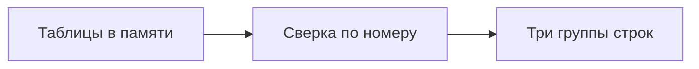

# Промт 04. Правила сверки по номеру

Ты добавляешь саму сверку. Пользователь ждёт три вида строк: номер есть в обоих файлах, но сумма или статус не совпали; номер есть только в выгрузке; номер есть только в отчёте. Совпавшие строки в результат не попадают. Пустой список в одной из групп — нормальный результат, не сбой.

Если у одного номера не сошлись и сумма, и статус, пользователь видит одну строку про сумму. В строке видны оба значения.

Письма никуда не уходят. Чужие системы робот не открывает.

## Что уже есть

Пункты 01–03 сделаны. Файлы проверяются, колонки читаются, повтор номера останавливает работу. Записи `rashozhdeniya.csv` ещё нет: этот пункт считает строки в памяти.

## Что сделать в этом пункте

Реализовать `sverit(vigruzka, otchet) -> rashozhdeniya` в памяти.

Ключ — `nomer` после trim.

Сравнение:

- сумма как число
- статус как текст без пробелов по краям

Тип строки результата:

- `summa` — номер в обоих файлах, суммы разные; если ещё и статус разный, тип всё равно `summa`
- `status` — номер в обоих файлах, суммы равны, статус разный
- `net-v-otchete` — номер только в выгрузке
- `net-v-vigruzke` — номер только в отчёте

Поля строки: `tip`, `nomer`, `summa_vigruzka`, `summa_otchet`, `status_vigruzka`, `status_otchet`. Где значения нет — пусто. Где номер есть в обоих — оба значения суммы и статуса видны.

Совпавшие номер, сумма и статус в список не входят.

Порядок групп в списке:

1. расхождение суммы или статуса
2. только в выгрузке
3. только в отчёте

Внутри группы — по `nomer` как по тексту.

Для учебных данных ожидание в памяти: три строки. 102, тип `summa`, суммы 500 и 450. 103, тип `net-v-otchete`. 104, тип `net-v-vigruzke`. Номера 101 нет. Разных номеров 4, расхождений 3.

## Чего не делать

Не записывать файл в этом пункте, если пункт 05 ещё не делали в том же прогоне агента: достаточно списка в памяти. Если пишешь заготовку записи — не дописывай строки вниз при повторном запуске. Не выдумывать блоки Designer. Не слать письма.

## Сценарий проверки

1. Учебные файлы: в списке три расхождения, 101 нет.
2. Мысленно убрать 103 и 104: группа «только в одном файле» пустая — это не сбой.
3. Номер с разной суммой и разным статусом даёт одну строку типа `summa`.

---

# Техническое приложение

## Файлы

| Путь | Зачем |
| --- | --- |
| `robot/sverka.process` | Сверка по номеру после чтения |
| `samples/vigruzka.csv` | Учебный вход |
| `samples/otchet.csv` | Учебный вход |
| `samples/expected-rashozhdeniya.csv` | Эталон строк, без записи в `Papka` если 05 ещё впереди |

## Методы и параметры

`sverit(vigruzka, otchet) -> rashozhdeniya`

`nomerov` — число разных номеров во множестве ключей выгрузки и отчёта.

`rashozhdeniy` — длина списка расхождений.

Правило конфликта суммы и статуса: одна строка, `tip = summa`.

## Примеры

Ожидаемые три строки для учебных данных:

```csv
summa,102,500,450,оплачен,оплачен
net-v-otchete,103,200,,новый,
net-v-vigruzke,104,,300,,оплачен
```

Кода Sherpa в репозитории может не быть текстовым фрагментом. Контракт — эти строки.

## Блок-схема



## Критерий готовности

Учебный набор даёт ровно три расхождения указанных типов. Совпавший 101 отсутствует. Конфликт суммы и статуса схлопывается в `summa`. Пустая группа допустима.
