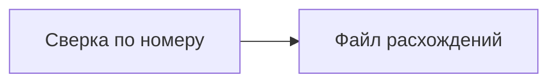

# Промт 05. Файл расхождений целиком

Ты записываешь то, что пользователь забирает из папки. Если оба файла на месте и сверка прошла, робот пишет новый файл расхождений. Вверху короткая сводка: сколько разных номеров он увидел и сколько расхождений нашёл. Ниже три группы строк.

Повторный запуск с теми же двумя файлами даёт тот же файл. Робот не дописывает вторую копию тех же строк вниз.

Совпавшие строки в файл не попадают. Пустой список в одной из групп — нормальный результат: файл всё равно создаётся, если сверка дошла до записи.

Письма никуда не уходят. Чужие системы робот не открывает.

## Что уже есть

Пункты 01–04 сделаны. Есть каркас, проверка файлов, разбор, правила сверки в памяти.

## Что сделать в этом пункте

Записать `rashozhdeniya.csv` в `Papka` целиком, одним новым файлом.

Первые две строки сводки: `nomerov` и `rashozhdeniy`.

Дальше заголовок колонок и строки трёх групп в порядке задания:

1. номер в обоих файлах, сумма или статус не совпали
2. номер только в выгрузке
3. номер только в отчёте

Внутри группы — по `nomer` как по тексту. Сумма без лишних нулей после запятой. Кодировка UTF-8, разделитель запятая.

Если сверка не дошла до успеха (нет файла, повтор номера), этот файл не создавать и старый не затирать пустым успехом.

## Чего не делать

Не дописывать в конец существующего файла. Не слать письма. Не выдумывать блоки Designer. Не менять тексты ошибок пунктов 02 и 03.

## Сценарий проверки

1. Положить учебную выгрузку и учебный отчёт. Запустить. Сводка: четыре номера, три расхождения. Строки 102, 103, 104. Номера 101 нет.
2. Запустить ещё раз с теми же файлами. Строки не задвоились, файл совпадает с ожидаемым.
3. Сравнить результат построчно с учебным ожиданием.

---

# Техническое приложение

## Файлы

| Путь | Зачем |
| --- | --- |
| `robot/sverka.process` | Запись результата целиком |
| `Papka/rashozhdeniya.csv` | Файл для пользователя |
| `samples/expected-rashozhdeniya.csv` | Эталон построчного совпадения |

## Методы и параметры

Запись только после успешного `sverit`.

Поля строк: `tip`, `nomer`, `summa_vigruzka`, `summa_otchet`, `status_vigruzka`, `status_otchet`.

Эталон:

```csv
nomerov,4
rashozhdeniy,3
tip,nomer,summa_vigruzka,summa_otchet,status_vigruzka,status_otchet
summa,102,500,450,оплачен,оплачен
net-v-otchete,103,200,,новый,
net-v-vigruzke,104,,300,,оплачен
```

## Примеры

Кода робота в текстовом виде может не быть. После сборки в Designer ожидаемый файл должен совпасть с эталоном построчно.

## Блок-схема



## Критерий готовности

Учебный прогон даёт файл, построчно равный `samples/expected-rashozhdeniya.csv`. Второй прогон не удваивает строки. При ошибке входа `rashozhdeniya.csv` не появляется как пустой успех.
