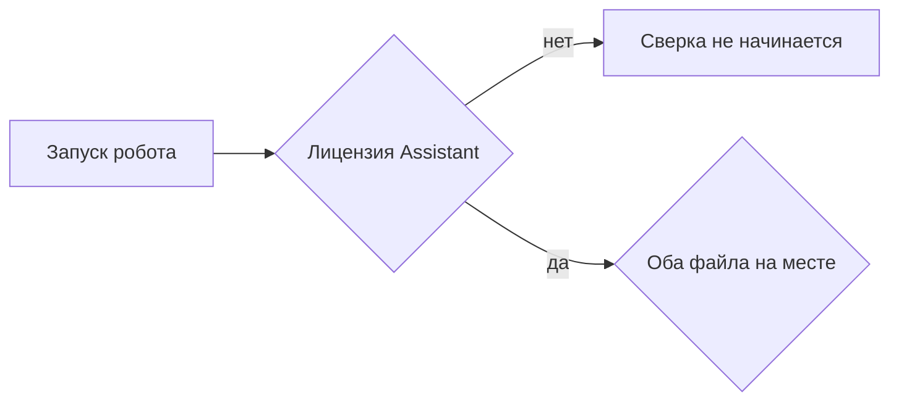

# Промт 06. Лицензия робота

Ты закрываешь условие запуска, которое пользователь встречает до сверки. Если лицензия робота не включена, сверка не начинается и файл расхождений не появляется. Пользователь ставит Sherpa Designer без лицензии. Чтобы прогнать робота, нужна лицензия Sherpa Assistant. На базовом курсе Sherpa её дают на месяц.

Письма никуда не уходят. Чужие системы робот не открывает.

## Что уже есть

Пункты 01–05 сделаны. При включённой лицензии робот уже умеет проверить файлы, сверку и запись `rashozhdeniya.csv`.

## Что сделать в этом пункте

Сверка начинается только если лицензия Sherpa Assistant включена. Это проверка среды Sherpa, не самодельный флаг внутри диаграммы.

Если лицензии нет:

- сверка не начинается
- `rashozhdeniya.csv` не появляется
- робот не читает выгрузку и отчёт как рабочий прогон сверки

В `README.md` оставить ссылки из задания: курс, дистрибутив Windows, документация. Написать, что Designer ставится без лицензии, а прогон нуждается в Assistant.

## Чего не делать

Не подделывать проверку лицензии блоком «если переменная равна да». Не выдумывать имена блоков Designer. Не слать письма. Не открывать чужие системы. Не считать отсутствие лицензии тем же случаем, что отсутствие файла: это разные отказы.

## Сценарий проверки

1. Без лицензии Assistant запустить робота. Сверка не началась, файла расхождений нет.
2. С лицензией и учебными файлами прогон из пункта 05 по-прежнему даёт три расхождения.
3. В инструкции видны ссылки на курс, дистрибутив и документацию.

---

# Техническое приложение

## Файлы

| Путь | Зачем |
| --- | --- |
| `README.md` | Как получить лицензию и где скачать Sherpa |
| `robot/sverka.process` | Не добавлять самодельную проверку лицензии |

Ссылки, которые должны остаться в README:

- https://sherparpa.ru/besplatnyj-bazovyj-kurs/
- https://docs.sherparpa.ru/ssylki-na-distributivy/distributivy-sherpa-rpa-windows
- https://docs.sherparpa.ru/sherpa-rpa

## Методы и параметры

Лицензия проверяется средой Sherpa Assistant до пользовательской диаграммы. В контракте робота нет параметра `licenziya=true`.

Поведение без лицензии: процесс сверки не стартует, `Papka/rashozhdeniya.csv` не создаётся этим запуском.

## Примеры

Кода проверки лицензии в диаграмме быть не должно. В README достаточно явной фразы, что прогон требует Sherpa Assistant, а Designer ставится без лицензии.

## Блок-схема

## Критерий готовности

Без лицензии файл расхождений не появляется. В диаграмме нет поддельной проверки. README содержит три ссылки из ТЗ.
