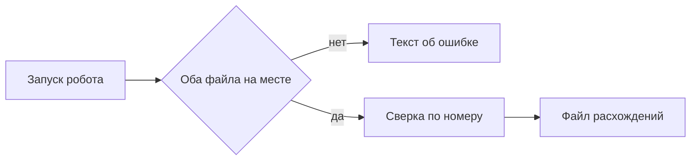

# Промт 07. Три проверки из задания

Ты доводишь робота до приёмки глазами пользователя. Человек кладёт учебные файлы, запускает «Сверка двух таблиц» и видит файл расхождений. Потом запускает ещё раз. Потом убирает отчёт.

Письма никуда не уходят. Чужие системы робот не открывает. Оркестратор, очереди и распознавание документов задуманы, ещё нет.

## Что уже есть

Пункты 01–06 сделаны: каркас, наличие файлов, разбор, сверка, запись, лицензия среды.

## Что сделать в этом пункте

Прогнать и закрепить три шага сценария проверки. Если что-то расходится с эталоном — исправить робота или учебные файлы так, чтобы совпало с контрактом задания, без выдуманных блоков Designer.

Шаг 1. Положить учебную выгрузку и учебный отчёт. Запустить робота. В файле расхождений сводка: четыре номера, три расхождения. Номер 102 с разными суммами. Номер 103 только в выгрузке. Номер 104 только в отчёте. Номера 101 в расхождениях нет.

Шаг 2. Запустить робота ещё раз с теми же файлами. Строки не задвоились.

Шаг 3. Убрать отчёт и запустить снова. Нового файла расхождений нет, в папке есть текст, что файл для сверки не найден. Если рядом лежал успешный `rashozhdeniya.csv` от шага 1, робот не подменяет его новым пустым успехом.

## Чего не делать

Не добавлять оркестратор, очереди, распознавание, почту. Не выдумывать блоки Designer. Не менять эталон ради удобства реализации. Не считать пустую группу ошибкой.

## Сценарий проверки

Это и есть работа пункта: три шага выше. После них учебный файл результата построчно совпадает с ожиданием, повтор чистый, отказ без отчёта честный.

---

# Техническое приложение

## Файлы

| Путь | Зачем |
| --- | --- |
| `samples/vigruzka.csv` | Учебная выгрузка шага 1 |
| `samples/otchet.csv` | Учебный отчёт шага 1 |
| `samples/expected-rashozhdeniya.csv` | Эталон шага 1 |
| `Papka/rashozhdeniya.csv` | Результат шагов 1–2 |
| `Papka/oshibka.txt` | Результат шага 3 |
| `robot/sverka.process` | Исправления, если прогон не совпал |

## Методы и параметры

Эталон шага 1:

```csv
nomerov,4
rashozhdeniy,3
tip,nomer,summa_vigruzka,summa_otchet,status_vigruzka,status_otchet
summa,102,500,450,оплачен,оплачен
net-v-otchete,103,200,,новый,
net-v-vigruzke,104,,300,,оплачен
```

Шаг 2: содержимое `rashozhdeniya.csv` после второго запуска байт-в-байт или построчно то же.

Шаг 3: `oshibka.txt` содержит `Не найден файл для сверки`; новый успешный `rashozhdeniya.csv` не создаётся.

## Примеры

Учебные входы как в пункте 01. Кода Sherpa в документ не выдумывать. После сборки в Designer ожидаемый файл должен совпасть с эталоном построчно.

## Блок-схема



## Критерий готовности

Три пункта сценария из `TZ.md` выполняются на учебной паре файлов. Эталон совпадает построчно. Повтор не двоит строки. Без отчёта — текст ошибки, без нового пустого успеха в файле расхождений.
