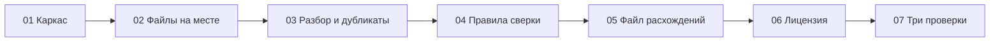

# Промты сверки двух таблиц

Пользователь запускает робота «Сверка двух таблиц» в Sherpa на своём компьютере. Робот смотрит одну папку, сравнивает выгрузку и отчёт и кладёт рядом файл расхождений. Письма никуда не уходят. Чужие системы робот не открывает.

Оркестратор, очереди задач и распознавание документов задуманы, ещё нет.

Промты идут по порядку. Каждый следующий считает предыдущие уже сделанными. Код робота и учебные файлы появляются по ходу пунктов, а не все сразу.

1. Каркас папки и учебные строки. Робот ещё ничего не сверяет.
2. Оба файла на месте. Если нет — текст об ошибке, старый файл расхождений не трогать.
3. Разбор колонок и повтор номера в одном файле.
4. Правила сверки по номеру и типы строк.
5. Запись файла расхождений целиком, со сводкой и тремя группами.
6. Без лицензии сверка не начинается.
7. Три проверки из задания: учебный прогон, повтор, снятие отчёта.

Сценарий проверки всей цепочки:

1. Пройти пункты с первого по седьмой по порядку.
2. Положить учебную выгрузку и учебный отчёт, запустить робота: четыре номера, три расхождения, номера 101 в файле нет.
3. Запустить ещё раз: строки не задвоились. Убрать отчёт: нового файла расхождений нет, в папке есть текст, что файл для сверки не найден.

---

# Техническое приложение

## Файлы

| Путь | Зачем |
| --- | --- |
| `TZ.md` | Исходное задание |
| `prompts/01-karkas.md` | Состав папки, имена файлов, учебные строки, README |
| `prompts/02-fajly-na-meste.md` | Проверка наличия выгрузки и отчёта |
| `prompts/03-razbor-i-dublikaty.md` | Колонки, сравнение, повтор номера |
| `prompts/04-pravila-sverki.md` | `sverit`, типы строк, пустые группы |
| `prompts/05-fajl-rashozhdenij.md` | Формат `rashozhdeniya.csv`, сводка, три группы |
| `prompts/06-licenziya.md` | Лицензия Sherpa Assistant |
| `prompts/07-tri-proverki.md` | Сценарий проверки из ТЗ |

Порядок запуска: `01` → `07`.

Карта покрытия `TZ.md`:

| Место в ТЗ | Промт |
| --- | --- |
| Таблица «Файлы», имена входов и результатов, учебные строки, README | 01 |
| Оба файла на месте, текст «Не найден файл для сверки», не подменять старый результат | 02 |
| Колонки, trim, сумма как число, повтор `nomer` | 03 |
| `sverit`, типы, одна строка если не сошлись сумма и статус, совпавшие не пишутся | 04 |
| Сводка `nomerov` / `rashozhdeniy`, три группы, повторный запуск без дописывания | 05 |
| Лицензия не включена — сверка не начинается | 06 |
| Сценарий проверки, пункты 1–3 | 07 |
| Оркестратор, очереди, распознавание, письма, чужие системы | вне всех промтов |

## Методы и параметры

Контракт результата во всех промтах один. UTF-8 CSV с запятой. Робот «Сверка двух таблиц». Рабочая папка — переменная `Papka`.

```csv
nomerov,4
rashozhdeniy,3
tip,nomer,summa_vigruzka,summa_otchet,status_vigruzka,status_otchet
summa,102,500,450,оплачен,оплачен
net-v-otchete,103,200,,новый,
net-v-vigruzke,104,,300,,оплачен
```

Внутри группы строки идут по `nomer` как по тексту. Сумма без лишних нулей после запятой.

## Примеры

Кода робота в репозитории ещё нет. Контракт прогона задают учебные строки в `TZ.md` и промт 01.

## Блок-схема


